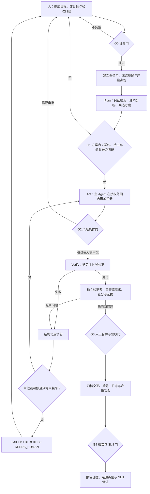

# 大模型协同设计工作流

## 1. 设计目标与总体架构

采用 **“确定性工程流水线＋一个主执行 Agent＋独立验证者＋人工审批门”**。

主 Agent 负责提出并实施一个可检验修改，确定性工具负责产生测试与测量证据，独立验证Agent负责寻找需求遗漏和证据缺口，人负责需求、接口、风险与最终验收。设计重点是任务契约、工具反馈、分层验证和可追溯交接，而不是堆叠智能体数量。

最小系统由六类组件构成：

1. **结构化任务包**：固定目标、范围、接口、验收和预算；
2. **Plan／Act 权限分离**：只读规划通过后才进入受限修改；
3. **可逆修改**：用版本、差分和回滚点约束 Agent 改动；
4. **分层验收命令**：静态、黄金参考、仿真、实现、板测和整机分别判定；
5. **原始交互记录**：以运行 ID 关联提示词、模型回答、工具结果和纠错；
6. **产物身份清单**：记录代码、模型、数据、BIT／HWH、日志和报告的 SHA256。

## 2. 主流程与状态流转



每次循环必须产生一个新的可审查差分或一份新的工具证据。没有新增信息时，不将重复生成视为有效重试。

## 3. 角色与职责

| 角色        | 输入             | 核心职责                | 输出              | 明确不负责           |
| --------- | -------------- | ------------------- | --------------- | --------------- |
| 人／模块负责人   | 作品目标、真实约束、风险判断 | 决定需求、接口、预算、验收与发布    | 已批准任务包、人工验收决定   | 不把目标与风险判断交给模型   |
| 确定性编排器    | 任务包、状态、工具白名单   | 控制状态转移、权限、超时、重试与退出  | 可恢复运行状态、完整轨迹    | 不允许模型自行无限重试     |
| 主执行 Agent | 最小充分上下文、授权路径   | 规划、生成差分、调用工具、解释失败   | 代码／文档差分、自检与交接材料 | 不扩大任务范围，不自证最终正确 |
| 独立验证者     | 原任务、最终差分、测试证据  | 寻找需求遗漏、反例、不当阈值和证据缺口 | 通过意见或阻断问题清单     | 不代替工具产生实测结果     |
| 验证工具      | 固定输入、脚本和工程产物   | 执行测试、仿真、综合、实现或板测    | 退出码、指标、日志与产物    | 不判断需求合理性和医学语义   |

独立验证者可以是另一模型，也可以是同一模型的全新上下文。独立性来自“不参与原实现，只依据原任务与证据审查”，而不是模型品牌数量。

## 4. 任务包与上下文组织

每个任务先建立版本化任务包，详细模板见 [task-packet.md](task-packet.md)。核心字段包括：

- `objective`：可观察目标；
- `allowed_paths`／`read_only_paths`：修改与只读边界；
- `non_goals`：禁止顺带改变的模型、接口、阈值或数据语义；
- `interface_refs`：当前 HWH、寄存器、布局、复位和指标合同；
- `acceptance`：可执行检查及目标验证层；
- `budgets`：修改—测试循环、相同错误重试和命令超时；
- `approval`：必须等待人的状态转换；
- `artifacts_to_record`：需要保存的差分、日志、报告和哈希。

上下文按“最小充分”原则组织：官方条款、当前接口合同和真实日志优先于模型记忆；只截取首个关键错误及必要前后文；每轮仅补充新错误所需材料；模型、数据、HWH 等输入附版本或哈希；凭据、隐私和可识别医学图像不得进入外部提示词或公开记录。

## 5. Plan／Act 与人工审批门

### Plan

只读检索代码、合同和历史失败，列影响文件、候选方案、验证层与回滚方式。缺少接口、输入或验收定义时暂停并询问人，不靠猜测进入实现。

### Act

只修改授权路径，只调用白名单工具，每轮验证一个主要假设。需求或接口变化、修改越界、需要安装删除或高风险上板时，立即停止并回到相应人工门。

### 五个人工检查点

| 检查点            | 审批内容                              |
| -------------- | --------------------------------- |
| G0 任务门         | 目标、非目标、权限、验收和预算是否完整               |
| G1 方案门         | 是否改变架构、PS／PL 接口、数据语义或约束           |
| G2 风险操作门       | 安装、删除、工作区外写入、不可逆操作、昂贵实现和高风险上板     |
| G3 合并与验收门      | 最终差分、实测结果、回滚方式与指标是否接受             |
| G4 报告与 Skill 门 | 协作记录是否真实，数字口径是否一致，Skill 效果是否有对应证据 |

## 6. 分层验证阶梯

任务包预先声明需要到达的验证层，后一层不能被前一层替代。

| 层级           | 典型检查                        | 产生的证据              |
| ------------ | --------------------------- | ------------------ |
| L0 静态检查      | 语法、lint、文件范围、禁止模式、文档链接      | 退出码、差分检查           |
| L1 单元／黄金参考   | 固定输入、参考输出、shape／dtype／布局和容差 | 比对报告、误差统计          |
| L2 仿真／协同仿真   | 边界帧、复位、背压、协议和多帧测试           | 波形、仿真日志、失败向量       |
| L3 HLS／综合／实现 | 资源、布局布线、setup／hold 和周期      | 工具版本、配置、报告和 DCP    |
| L4 上板一致性     | Overlay、寄存器、DMA、固定输入与参考输出   | BIT／HWH 哈希、板测日志和结果 |
| L5 整机端到端     | 视频、质量门、抓拍、推理、显示和存档          | 原始结果、性能分布和异常记录     |

报告中的每个数字都标明来自哪一层。例如，布线后时序通过不能写成整机功能通过，局部 CNN 候选实现不能写成完整视频系统已部署。

## 7. 反馈、有界重试与退出

失败时生成结构化反馈包：运行 ID、失败阶段、命令、退出码、首个关键错误、日志引用、当前差分哈希、失败样例、允许的下一改动和重试序号。

设计默认预算为：每个任务最多 3 次“修改—测试”循环，同一错误指纹最多自动重试 2 次；具体数值可由任务负责人按成本调整。

出现以下情况立即停止自动循环：

- 相同错误重复且没有新增证据；
- 失败原因超出原接口合同或授权范围；
- 所需文件缺失、测试随机失败或预算耗尽；
- 需要删除失败用例、降低精度容差、放宽时序约束或改变医学／质量门语义才能通过；
- 工具超时或执行器异常，重新运行可能产生未知副作用。

成功退出要求指定验证层通过、差分未越界、证据归档、独立审查无阻断问题且人工审批完成。其余情况以 `FAILED`、`BLOCKED` 或 `NEEDS_HUMAN` 受控退出，保存已排除假设和最后一致状态。

## 8. 模型分工与多 Agent 使用边界

模型分工是执行路由，不是能力宣传：

- **主执行 Agent**：仓库理解、代码差分、测试驱动修复和长程工程任务；
- **独立诊断／验证者**：第二意见、日志分类、反例和证据缺口审查；
- **长文档与报告 Agent**：赛题条款、历史材料、报告数字和证据一致性整理。

运行时记录实际请求模型、返回快照、执行器和 Skill 版本，区分模型能力、执行器权限与 Skill 规范对行为的影响。

默认不采用重型多智能体。仅在三类场景增加并行角色：

1. 并行只读检索官方文档、历史失败和候选实现；
2. 独立审查原任务、差分和证据；
3. 在隔离副本中探索 PS／PL 候选，由人按接口合同选择，不并行修改主线。

## 9. 运行追踪与协作记录

最小追踪单位不是一次聊天，而是一次具有明确输入、代码基线、模型配置、工具执行和测试结果的运行。每次运行以 `task_id` 和 `run_id` 关联：

- 实际提示词、模型原始回答和工具结果；
- 父运行与后续纠错运行；
- 代码基线、上下文清单和差分哈希；
- 模型与执行器版本；
- 数据、模型、BIT／HWH 和报告身份；
- 最高验证层、退出状态和人工决定。

设计中以原始交互 JSONL 和产物清单作为完整档案；竞赛报告从中选择少量能体现“提示—回答—反馈—修正—验证”的代表案例，而不是将全部聊天堆入报告。

## 10. 交接与 Skill 闭环

交接回执必须包含完成项、基线、差分、验证层、失败假设、人工决定、清理状态、未解决问题和下一负责人动作。

Skill 从真实工程过程中生长：

```text
真实失败或重复观察
  → 保存最小复现与原始证据
  → 提取可执行判定规则
  → 形成项目专用检查单／脚本
  → 编写可触发、可验证的 Skill
  → 在后续任务中应用并根据失败修订
  → 将项目事实送入报告，将可复用流程保留为 Skill
```

在 Round A 形成的 Skill，可在 Round A＋1～A＋N 持续使用并积累有效性证据；没有长期演进历史也不妨碍先形成 Skill。成熟度只描述证据覆盖，不作为 Skill 的存在门槛。
