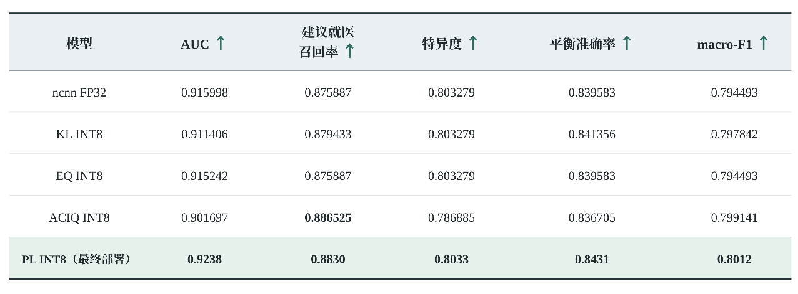
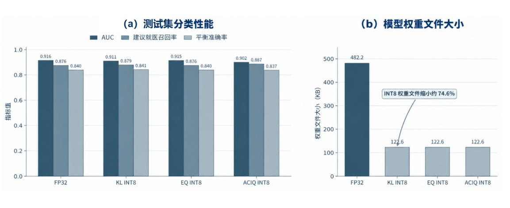
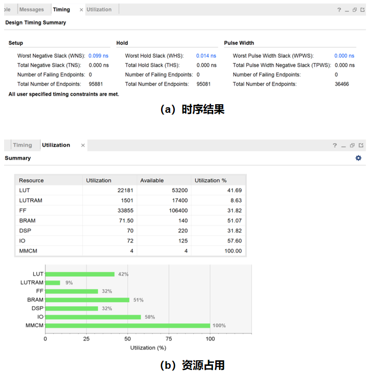
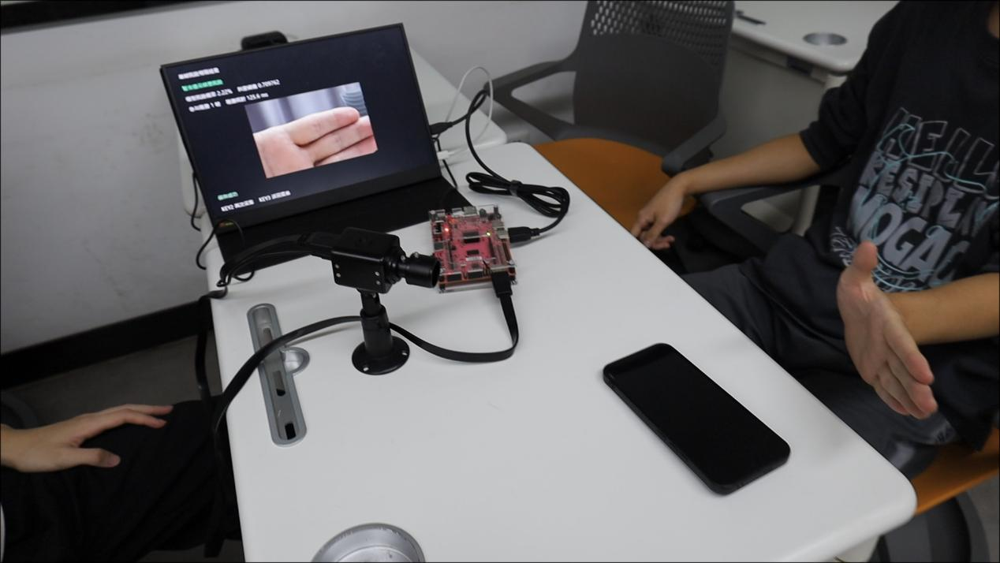
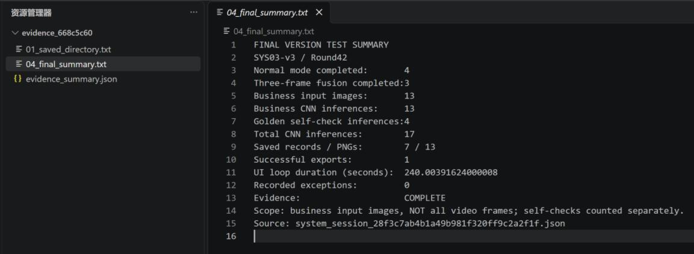
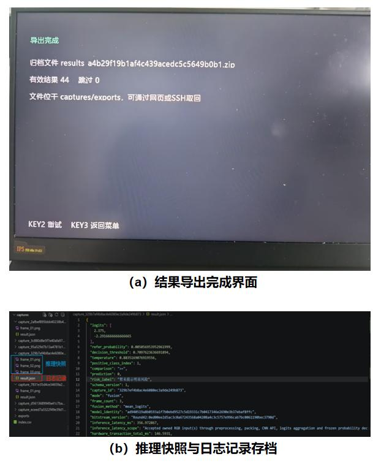

# 测试与实测结果

本文汇集 DermaFlow 皮肤病变智能预筛终端的模型评估、CPU 基线、PL 加速电路及整机运行结果，整理自[正式技术报告](technical_report.pdf)第 3.3.6、3.4.4、4.3、4.4 节和第 5 章。表格数据沿用报告，图片直接提取自报告；各项结果按原测试范围分别列示。

## 测试条件

板端平台为 PYNQ-Z2，器件为 AMD/Xilinx Zynq-7000 XC7Z020，使用 PYNQ 3.1.1 和 Python 3.10.4。外接 HDMI 摄像头与显示器，视频输入为 1280×720、60 帧/s，CNN 核心工作频率为 80 MHz。

模型采用 PAD-UFES-20 数据，按患者划分训练、验证与测试集，分别为 1610、342 和 343 张。正类为 ACK、BCC、MEL、SCC，负类为 NEV、SEK。模型输入为 128×128 RGB 图像，CPU 与 PL 使用相同的预处理、类别顺序和判定含义。来源及处理说明见[数据集说明](../data/dataset/README.md)。

## 模型分类性能与存储开销

以下结果来自同一 343 张测试集。各 CPU 候选模型使用与自身输出分布匹配的温度系数和判定阈值。KL INT8 是 CPU 侧主要量化模型；PL 使用单独确定的硬件定点格式和工作点。

| 模型 | AUC | 建议就医召回率 | 特异度 | 平衡准确率 | macro-F1 |
|---|---:|---:|---:|---:|---:|
| ncnn FP32 | 0.915998 | 0.875887 | 0.803279 | 0.839583 | 0.794493 |
| KL INT8 | 0.911406 | 0.879433 | 0.803279 | 0.841356 | 0.797842 |
| EQ INT8 | 0.915242 | 0.875887 | 0.803279 | 0.839583 | 0.794493 |
| ACIQ INT8 | 0.901697 | 0.886525 | 0.786885 | 0.836705 | 0.799141 |
| PL 定点模型 | 0.9238 | 0.8830 | 0.8033 | 0.8431 | 0.8012 |

上述表格对应正式报告表 8。ncnn FP32、KL INT8、EQ INT8 的总体准确率分别为 86.30%、86.59%、86.30%；PL 为 86.88%，混淆矩阵为 `[[49, 12], [33, 249]]`，行表示真实类别、列表示预测类别，类别顺序为负类、正类。

| 部署模型 | 温度系数 | 判定阈值 |
|---|---:|---:|
| ncnn FP32 | 0.883238 | 0.709830 |
| KL INT8 | 0.890488 | 0.697674 |
| EQ INT8 | 0.876223 | 0.721251 |
| PL 定点模型 | 0.883517 | 0.709762 |

FP32 权重文件为 482,204 字节，INT8 权重文件为 122,616 字节，减少约 74.57%。KL INT8 对 ACK、BCC、SCC 的建议就医召回率分别为 89.34%、90.48%、86.36%；MEL 测试样本为 12 张、涉及 8 名患者，对应召回率为 50.00%。

## CPU 基线与 PL 统一入口计时

下表统一以“标准化 FP32 输入到两个原始得分输出”为计时范围。PL 完整调用包含定点转换、输入打包、DMA 传输及输出检查。该范围不包含图像解码、缩放、归一化、质量等待、界面生成和文件保存。

| 实现 | 平均耗时 / ms |
|---|---:|
| PYNQ-Z2 ARM，ncnn FP32 | 92.900 |
| PYNQ-Z2 ARM，KL INT8 | 72.859 |
| PYNQ-Z2 ARM，EQ INT8 | 72.885 |
| PL 完整推理调用 | 69.498 |

在此计时范围内，PL 完整调用较 ARM KL INT8 平均耗时降低约 4.61%。PC 与 ARM 的原始计时材料另见 [CPU 评估资料](../data/evaluation/README.md)。

PL 调用内部的不同计时范围对应正式报告表 11：

| 计时范围 | 平均耗时 / ms | P95 耗时 / ms |
|---|---:|---:|
| CNN 硬件事务 | 48.864 | 48.867 |
| 启动至输出检查完成 | 49.818 | 50.258 |
| 标准化 FP32 输入至原始得分输出 | 69.498 | 70.476 |

这三行分别描述硬件事务、内部调用和完整 PL 调用。与 CPU 比较时采用最后一行。

## 加速电路资源、时序及数值一致性

| 实现范围 | LUT | FF | BRAM Tile | DSP | 建立时间裕量 | 保持时间裕量 |
|---|---:|---:|---:|---:|---:|---:|
| CNN 独立计算链及 AXI 包装 | 4206 | 4030 | 54.5 | 40 | +1.251 ns | +0.009 ns |
| 视频、质量门、CNN、DMA 完整系统 | 22181 | 33855 | 71.5 | 70 | +0.099 ns | +0.014 ns |

完整系统的 LUT、FF、BRAM、DSP 分别占器件可用资源的 41.69%、31.82%、51.07%、31.82%。建立时间、保持时间和脉冲宽度检查均无失败端点。

数值验证依次覆盖软件定点参考、C 仿真、有限深度 FIFO 的 RTL 仿真、板端固定输入和测试集推理。连续四组固定输入在帧间不复位时均得到预期结果，下游暂停接收时输出保持稳定。343 张测试图像的 PL 输出与冻结软件定点参考在原始编码、恢复得分、概率和阈值判定上保持一致。

实现原始报告见 [Vivado 综合与实现报告](../build/reports/README.md)，逐样本评估及板端测试原件见[板端实测记录](../board/results/README.md)。

## 质量门控与 PS 端处理

PL 质量统计发布速率约为 60.005 帧/s，对应 720p60 视频输入。PS 仅对候选抓拍图像执行复核，单张图像质量复核平均耗时为 153.969 ms。质量门最终采用平均亮度范围 40～210、暗像素比例上限 5%、亮像素比例上限 2%、Sobel 均值下限 20。抓拍图像、质量统计、标志位和文件的 16 项检查全部通过。

正式报告表 16 对 PS 软件环节进行了独立优化对照：

| 环节 | 优化前 / ms | 优化后 / ms | 降幅 |
|---|---:|---:|---:|
| 单张图像预处理、打包及记录生成 | 92.663 | 63.464 | 31.51% |
| 单次结果页生成 | 193.640 | 70.117 | 63.79% |
| 单张 PNG 编码及写入 | 1286.077 | 222.812 | 82.68% |
| 正常模式相关组件合计 | 496.759 | 298.868 | 39.84% |
| 三帧融合模式相关组件合计 | 1066.306 | 737.789 | 30.81% |
| 正常模式完整归档中位数 | 1564.192 | 529.814 | 66.13% |
| 三帧融合完整归档中位数 | 5133.031 | 1458.033 | 71.60% |

“相关组件合计”只包含质量复核、模型输入生成和结果页生成，不包含质量等待、CNN 计算、视频传输和文件归档。PNG 仍为无损保存；该优化对照中的文件体积从 241,600 字节增加至 281,694 字节。

另一次界面响应测试完成 6 组正常模式和 2 组三帧融合模式，共处理 12 张图像、执行 12 次 CNN 推理，8 组结果均完成保存与导出。从质量复核完成到结果页首次显示，正常模式平均耗时为 220.064 ms，三帧融合模式为 463.814 ms。这是独立测试批次，与下节连续运行测试的任务数量分别统计。

## 整机操作与连续运行

系统操作覆盖实时预览、质量检测、自动抓拍、单帧与三帧融合推理、结果显示、本地保存和批量导出。

正式报告表 17 的连续运行测试结果如下：

| 验证项目 | 测试结果 |
|---|---|
| 视频输入规格 | 1280×720，60 帧/s |
| PL 质量门控统计速率 | 约 60.005 帧/s |
| UI 主循环运行时间 | 240.004 s |
| 正常模式完成次数 | 4 次 |
| 三帧融合完成次数 | 3 次 |
| 业务输入图像 | 13 张 |
| 业务 CNN 推理 | 13 次 |
| 固定输入启动自检 | 4 次 |
| CNN 调用总次数 | 17 次 |
| 结果记录 | 7 组 |
| 保存图像 | 13 张 |
| 批量导出 | 成功 1 次 |
| 记录异常 | 0 次 |

业务图像数为 `4×1 + 3×3 = 13`，CNN 调用总数为 `13 + 4 = 17`。业务图像数量不包含实时预览帧。该测试确认功能衔接、计数、存档和连续运行，分类指标采用前述固定测试集的结果。

## 结果保存与导出

每次任务建立独立记录，保存参与推理的图像及 `result.json`，内容包括工作模式、各帧概率、融合结果、阈值、推理耗时和质量复核信息。主菜单导出功能将有效记录整理为压缩文件。

图中 44 条有效记录来自此前多轮功能测试的累计导出；连续运行测试中的 7 组结果只统计上述 240.004 s 会话，二者范围不同。

报告中的正向提示演示使用公开数据集样例显示于移动终端，再由摄像头采集，用于检查质量门、推理、三帧融合、提示和保存流程。该演示不作为测试集准确率的计算依据。

系统部署、按键操作和输出文件位置见[完整系统复现说明](reproduction.md)。
