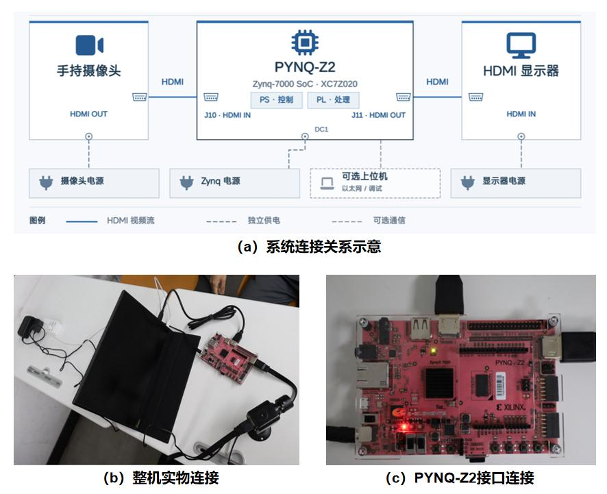
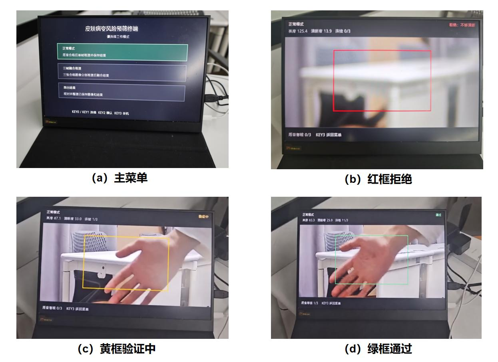
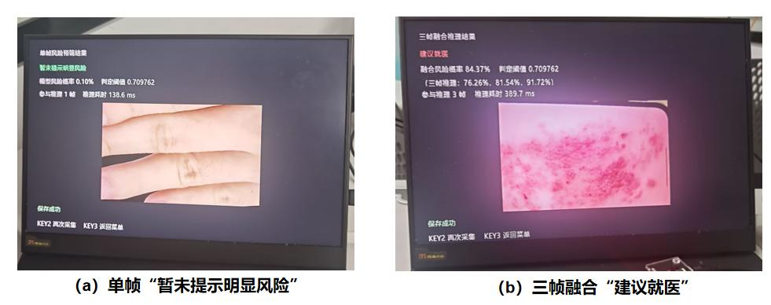

# 完整系统复现说明

本文说明 DermaFlow 皮肤病变智能预筛终端的板端部署与操作方法，整理自[正式技术报告第 8 章](technical_report.pdf#page=64)，并将启动命令与本仓库入口对齐。

复现使用已生成的整机位流、配套硬件描述和板端程序，无需先重新训练 CNN、量化模型或生成位流。复现内容包括实时取景、图像质量检测、自动抓拍、CNN 推理、单帧与三帧融合结果显示、文件保存和导出。

## 获取工程

公开仓库：[DermaFlow-A-Zynq-Based-Skin-Lesion-Risk-Pre-Screening-System](https://github.com/Foracia/DermaFlow-A-Zynq-Based-Skin-Lesion-Risk-Pre-Screening-System)。在需要保存工程的位置执行：

```bash
git clone https://github.com/Foracia/DermaFlow-A-Zynq-Based-Skin-Lesion-Risk-Pre-Screening-System.git dermaflow
cd dermaflow
```

也可以下载仓库文件后解压。下文“工程根目录”均指直接包含 `src/`、`board/`、`data/` 等目录及根 README 的位置；示例工程文件夹名为 `dermaflow`。

## 运行平台与外部连接

| 项目 | 配置 |
|---|---|
| 开发板 | PYNQ-Z2 |
| 核心器件 | AMD/Xilinx Zynq-7000 XC7Z020，工程器件型号 `xc7z020clg400-1` |
| 板端系统 | 项目使用的 PYNQ 3.1.1 镜像，Python 3.10.4 |
| 摄像头 | HDMI 输出，1280×720、60 帧/s |
| 显示器 | 连接开发板 HDMI 输出端口 |
| 存储与供电 | 启动用 microSD 卡及开发板电源 |
| 部署连接 | 上位机通过网口或 USB 转网口复制工程、取回结果 |

摄像头接入开发板 HDMI 输入端口，开发板 HDMI 输出端口接入显示器。系统通过板载按键交互，无需外接键盘或鼠标。



## 复现文件

以下文件位置均相对于工程根目录。

| 文件或目录 | 用途 |
|---|---|
| `README.md` | 项目功能、目录结构及主要运行入口 |
| `requirements.txt` | NumPy、Pillow、psutil 等 Python 依赖 |
| `board/boot/boot.py` | PYNQ 启动配置，由系统入口统一管理 FPGA 加载 |
| `board/boot/README.md` | 首次安装、启动配置核对及重启步骤 |
| `board/run_ui.py` | 完整系统统一入口，执行文件检查或启动交互程序 |
| `board/hardware/cnn_system.bit` | 包含视频、质量门、CNN 和 DMA 的整机位流 |
| `board/hardware/cnn_system.hwh` | 与位流配套的硬件接口描述 |
| `board/hardware/manifest.json` | 部署文件的身份及完整性清单 |
| `board/hardware/board_stage_probe.py` | HWH、位流加载与控制接口的分阶段诊断工具 |
| `board/system_ui/` | 菜单、按键、视频采集、质量复核、推理、保存和导出程序 |
| `data/models/` | 模型接口、预处理参数、数据划分及 PL 定点参数 |
| `board/results/` | 已有板端测试原始记录 |
| `src/`、`sim/`、`build/` | 设计源码、开发验证材料和构建文件 |
| `build/scripts/deploy_build.py` | 重建 BIT／HWH 部署、接口核对及关联清单刷新 |
| `skill/`、`report/` | 技能包、协作材料、正式报告及说明 |

将完整工程复制到板端，保持目录结构。位流、HWH、程序及参数作为一套文件使用。完整外部数据集用于固定划分的模型评估，运行摄像头采集与推理流程无需下载完整数据集。

## 从源码重建后部署

直接运行随包硬件时使用下一节。需要重新生成整机硬件时，在安装 Vivado 2025.2 的 PC 上，从工程根目录依次执行：

```bash
vivado -mode batch -source build/scripts/build_system.tcl
python build/scripts/deploy_build.py
```

第一条在 `build/output/` 生成 `system.bit` 和 `system.hwh`；第二条核对器件及关键接口，将两者部署为 `board/hardware/cnn_system.bit` 和 `cnn_system.hwh`，并刷新硬件、界面及批处理的关联清单。完成后把整个工程复制到板端。详细构建方法见 [构建说明](../build/README.md)。

## 部署与启动

以下命令均在板端工程根目录执行。Python 路径对应项目使用的 PYNQ 镜像。首次部署先按 [PYNQ 启动配置](../board/boot/README.md)备份原 `/boot/boot.py`、安装随包文件、核对 SHA256 并重启；随后执行以下步骤。

1. 连接摄像头与显示器，进入工程根目录。在项目 PYNQ Python 环境中准备依赖：

   ```bash
   sudo /usr/local/share/pynq-venv/bin/python3 -m pip install -r requirements.txt
   ```

2. 若系统配置了自动运行服务，先停止服务，释放视频与 DMA 的使用权：

   ```bash
   sudo systemctl stop derm-terminal.service
   sudo systemctl stop derm-ui.service
   ```

   未安装相应服务时，跳过该项。其他使用视频或 DMA 的程序也应先退出。

3. 检查部署文件：

   ```bash
   python3 board/run_ui.py
   ```

   该命令不访问硬件，核对程序、位流、HWH 和配套清单。成功标记为 `SYSTEM_PACKAGE_VERIFIED_NO_HARDWARE_ACCESSED`。

4. 加载整机位流并启动系统：

   ```bash
   sudo env XILINX_XRT=/usr /usr/local/share/pynq-venv/bin/python3 board/run_ui.py --load --run
   ```

   统一入口执行设备独占检查、一次位流加载和界面启动。默认持续运行；在命令末尾添加 `--seconds 120` 可进行 120 秒限时运行。仅在配套位流已经正确加载的情况下，才省略 `--load` 并使用 `--run`。

常驻服务的安装方法见 [板端部署说明](../board/README.md)。分阶段硬件探针 `board/hardware/board_stage_probe.py` 用于独立排查 HWH、位流加载、控制接口和 DMA 状态，日常启动使用上述统一入口。

## 操作流程

KEY0 和 KEY1 切换菜单，KEY2 确认，功能页 KEY3 返回。首页 KEY3 进入关机确认，KEY2 确认关机，KEY3 取消。



进入采集页面后，将待拍部位置于中央取景框内，根据亮度、清晰度、连续合格计数及拒绝原因调整位置和光照。系统持续预览；质量不合格时继续等待，质量合格后自动抓拍，并对实际取得的图像进行 PS 侧复核。

| 模式 | 操作与预期结果 |
|---|---|
| 正常模式 | 一张复核合格图像执行一次 CNN 推理，显示风险概率、阈值及提示，保存一张图像和对应结果 |
| 三帧融合 | 三张复核合格图像分别执行推理；对三组原始得分求平均，再计算融合概率和判定，保存三张图像和对应结果 |
| 导出结果 | 核对已保存的记录，生成包含图像及结果信息的压缩包，界面显示导出数量和位置 |



在结果页面，KEY2 可再次采集，KEY3 返回菜单。退出时程序释放视频、DMA 和 CNN 缓冲区。

## 输出文件与功能检查

默认运行目录为 `board/system_ui/runs/`，`system_session_*.json` 保存会话记录。该目录下的 `captures/` 保存各次采集的图像与 `result.json`，`captures/index.csv` 保存结果索引，导出的压缩包位于 `captures/exports/`。可通过网页或 SSH 从板端取回。

复现时依次检查：

1. 主菜单与板载按键响应正常。
2. 摄像头输入和实时预览正常，画面能随场景连续更新。
3. 过暗、过亮和模糊画面会被质量门控拒绝，并显示原因。
4. 正常模式完成一次推理，图像和结果能够对应保存。
5. 三帧融合完成三次推理，显示各帧与融合结果，参与推理帧数为 3。
6. PNG 图像、JSON 结果和 CSV 索引能够对应。
7. 主菜单导出功能正常，压缩包可以取回。
8. 程序退出后能够再次启动，视频及 DMA 资源正常释放。

固定测试集上的分类指标、统一入口计时、资源与时序及整机测试结果见[测试与实测结果](measurements.md)。少量摄像头演示图像用于检查系统功能，分类性能采用固定测试集的评估结果。
